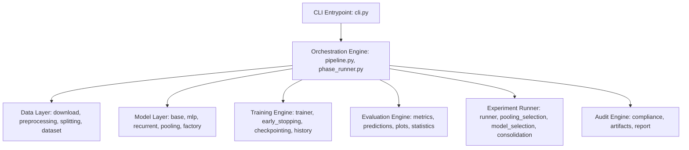

# Arquitetura do Software e Separação de Responsabilidades

O repositório é projetado seguindo princípios sólidos de Engenharia de Software, com desacoplamento rigoroso entre camadas funcionais dentro de `src/project4_rnn/`.

## 1. Visão Arquitetural

## 2. Descrição das Camadas

1. **`project4_rnn.config` e `constants`**: Configuração central declarativa baseada em dataclasses validadas a partir de arquivos YAML.
2. **`project4_rnn.data`**: Pipeline de obtenção de dados, binarização sem vazamento, divisão estratificada determinística e criação de DataLoaders.
3. **`project4_rnn.models`**: Implementação das arquiteturas neurais (MLP, GRU, LSTM) e módulos de pooling temporal.
4. **`project4_rnn.training`**: Loop de otimização, parada antecipada com `patience`, salvamento de checkpoints pelo menor `val_loss` e histórico por época.
5. **`project4_rnn.evaluation`**: Cálculo de métricas (Balanced Acc, F1, ROC-AUC, PR-AUC, Especificidade) e geração de gráficos de publicação.
6. **`project4_rnn.experiments`**: Execução de configurações nas 5 sementes, regras de seleção e consolidação de resultados.
7. **`project4_rnn.orchestration`**: Grafo acíclico direcionado (DAG), plano de execução, suporte a `--dry-run`, `--resume`, `--force` e rastreamento de proveniência.
8. **`project4_rnn.audit`**: Inspeção de conformidade, validação de parâmetros analíticos e geração do relatório de auditoria em Markdown.
