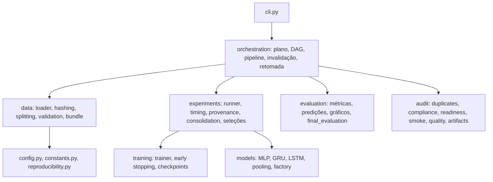

# Arquitetura do Software

> O experimento completo **não foi executado** nesta etapa.

## 1. Visão em camadas

## 2. Módulos

| Pacote | Responsabilidade |
|---|---|
| `data` | contrato do dataset, `hash_series`, split agrupado, `DataBundle` (partições + `dataset_hash` + `split_hash`), fixtures sintéticas |
| `models` | MLP-32, GRU/LSTM e poolings; `build_model` valida a contagem de parâmetros |
| `training` | `Trainer`, `EarlyStopping` (`val_loss`), checkpoints |
| `experiments` | `run_single_seed`, `timing` (campos obrigatórios), `provenance` (seed, checkpoint, SHA-256), consolidação e seleções |
| `evaluation` | métricas, predições, gráficos, avaliação do teste e sensibilidade |
| `orchestration` | DAG, `build_execution_plan` (dry-run puro), `run_full_pipeline`, `invalidation`, `resume` |
| `audit` | duplicatas, conformidade científica, prontidão técnica, smoke test, qualidade, limpeza segura |

## 3. Decisões de projeto

1. **Identidade dos dados.** `dataset_hash` (sem timestamp) e `split_hash` acompanham cada execução (`status.json`), a seleção de pooling, a seleção final e o teste. Hash divergente ⇒ artefato obsoleto.
2. **Sem `data_validation`.** O nó apenas repetia o carregador; contrato e integridade do split agora fazem parte de `build_data_bundle`.
3. **Dry-run puro.** `build_execution_plan` lê somente a configuração e, se existir, o JSON do split; não cria diretórios, não abre checkpoints, não treina.
4. **Ciclos de importação evitados.** Constantes compartilhadas (`SENSITIVITY_ARTIFACT_NAMES`) ficam em `constants.py`; `experiments/__init__` não reexporta a consolidação.
5. **Recursos fechados.** `run_single_seed` fecha o `FileHandler` de `run.log` (necessário no Windows).

## 4. PRÓXIMA EXECUÇÃO EXPERIMENTAL

Para execução posterior pelo usuário (não executados aqui): `clean-artifacts --generated-only`; `run-full-experiment --config configs/base.yaml --fail-fast`; em caso de interrupção, `--resume --fail-fast`.
