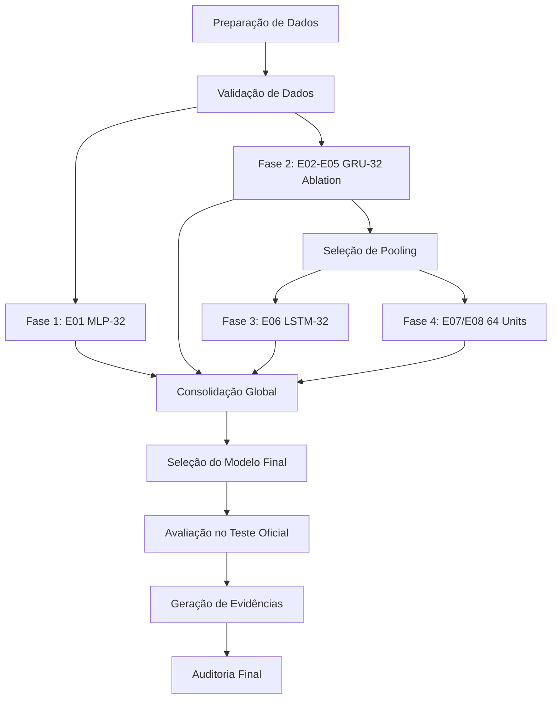

# Orquestração do Pipeline, DAG e Reentrância

## 1. Grafo de Dependências (DAG)

## 2. Reentrância e Idempotência

- **`SKIP`**: Se todos os artefatos obrigatórios do experimento existirem e os hashes coincidirem, o orquestrador pula o treinamento.
- **`RERUN`**: Se houver artefatos corrompidos, ausentes ou se `--force` for utilizado.
- **`INVALIDATE`**: Mudanças de configuração invalidam apenas os experimentos dependentes; alterações no pooling invalidam as fases 3 e 4.

## 3. Identificador de Proveniência

Cada execução completa cria uma pasta `artifacts/pipeline_runs/full_run_YYYYMMDD_HHMMSS/` contendo o plano de execução, configuração resolvida, manifesto do dataset, logs e relatório executivo final em Markdown.
