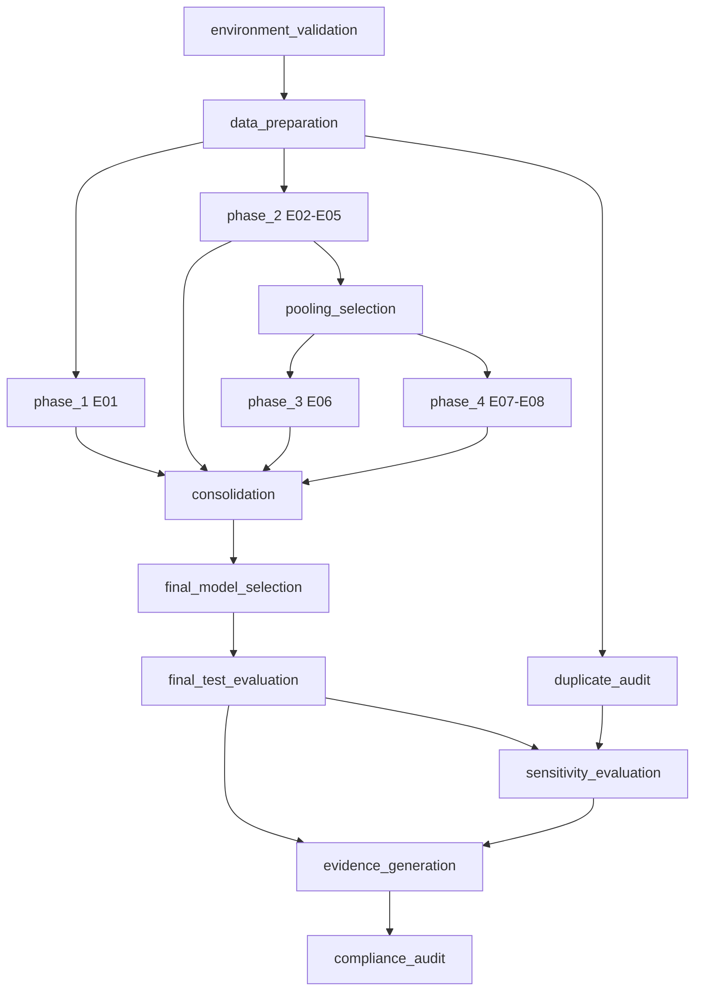

# Orquestração do Pipeline

> O experimento completo **não foi executado** nesta etapa. Apenas o plano (`--dry-run`), fixtures e testes técnicos foram executados.

## 1. DAG

O grafo é construído por `build_standard_pipeline_graph()` ([`dependency_graph.py`](../src/project4_rnn/orchestration/dependency_graph.py)).



### 1.1 Remoção do nó `data_validation`

O antigo nó `data_validation` apenas reexecutava o carregador do dataset. Sua responsabilidade (contrato do dataset, NaN/Inf, mapeamento de rótulos, integridade do split) passou a fazer parte de `data_preparation` (`build_data_bundle`), executada em toda carga de dados. O comando `validate-data` continua disponível como verificação avulsa. Dependências, testes e documentação foram atualizados.

### 1.2 Novos nós

- `duplicate_audit`: auditoria de duplicatas por hash (`artifacts/audits/duplicate_overlap_audit.json`).
- `sensitivity_evaluation`: análises descritivas do modelo congelado (teste sem sobreposição exata e sem grupos conflitantes). Nunca usada para seleção.

## 2. Identidade dos dados e invalidação

Cada execução grava `dataset_hash` (sem timestamp) e `split_hash` em `status.json`. O hash do split é calculado sobre o conteúdo dos índices; um novo split gera um novo hash.

- `find_stale_runs` / `find_stale_summaries` listam execuções e sumários cujo `split_hash` difere do atual ou está ausente.
- `mark_artifacts_obsolete` grava `artifacts/OBSOLETE_ARTIFACTS.json` (não apaga nada), com `current_split_hash`, os itens obsoletos e a ação recomendada.
- O pipeline chama `mark_artifacts_obsolete` ao iniciar; uma execução com `split_hash` divergente **nunca** é reutilizada na retomada.
- `invalidate_experiment` e `invalidate_pooling_and_downstream` removem sumários derivados quando uma configuração ou o pooling mudam.
- `StaleArtifactError` é levantada quando um artefato com `split_hash`/`dataset_hash` divergente é consumido (seleção de pooling, seleção final, avaliação).

## 3. Retomada (`--resume`)

`is_step_completed` considera um passo concluído apenas se todas as saídas esperadas existirem e não estiverem vazias; `artifacts/...` é resolvido em `--artifacts-dir`. As execuções individuais só são reaproveitadas se `config_hash`, `split_hash` e `dataset_hash` coincidirem. `--resume` e `--force` são mutuamente exclusivos.

## 4. Falhas

`--fail-fast` (padrão) interrompe no primeiro passo com erro (`StepFailedError`); `--continue-on-error` continua e relata as falhas ao final. As duas opções são mutuamente exclusivas.

## 5. Dry-run puro

`run-full-experiment --dry-run` usa `build_execution_plan`, que lê somente a configuração e, se existir, o JSON do split. Ele informa 8 configurações, 5 sementes, 40 execuções futuras, dependências, split e hashes, estado do pooling, avaliações futuras e artefatos esperados. **Não** treina, não abre checkpoints, não avalia o teste, não cria diretórios e não gera métricas.

## 6. Limites desta etapa

Pipeline em modo real, fases 1–4 e avaliação final **não foram executados**. A validação foi feita por testes de orquestração com stubs e fixtures.

## 7. PRÓXIMA EXECUÇÃO EXPERIMENTAL

Para execução posterior pelo usuário (**não executados** aqui):

```powershell
python -m project4_rnn.cli clean-artifacts --generated-only

python -m project4_rnn.cli run-full-experiment --config configs/base.yaml --fail-fast

# em caso de interrupção
python -m project4_rnn.cli run-full-experiment --config configs/base.yaml --resume --fail-fast
```
